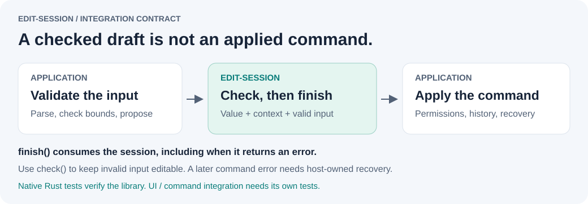

# edit-session

Draft editing with document, target and revision checks. A standalone Rust library;
the separate [interaction-check](https://github.com/PerchAnton/interaction-check) tool is
an optional way to test consumer workflows, not a dependency of this crate.

[](https://github.com/PerchAnton/edit-session/actions/workflows/ci.yml)

**[Get started](#use-from-another-project)** · **[Evidence and trade-offs](docs/ADOPTION.md)** · **[API source](src/lib.rs)** · **[MIT OR Apache-2.0](#license)**


### The numbers behind the overview

Evidence snapshot: **26 October 2026**. The CI badge is live; the graphic and counts are
dated measurements. Each figure has a source and a defined scope.

| Measure | Recorded result | Source and scope |
| --- | --- | --- |
| Runtime dependencies | **0** | [Manifest](Cargo.toml); `no_std`, unsafe code forbidden |
| Library checks | **16 + 1 pass** | [16 lifecycle tests](tests/lifecycle.rs) + [1 compile-fail doctest](src/lib.rs); CI checks Rust 1.88 and stable |
| Recovery example | **8 pass** | [Runnable host example and native tests](examples/retry_command.rs); model checks, separate from consumer UI regressions |
| Proposed PdfCraft regression checks | **0/2 → 2/2 pass** | [Two stale-draft workflows](docs/ADOPTION.md#a-demonstrated-failure-in-a-real-consumer), recorded 25 October; results cover the complete consumer patch |
| Proposal/check loop | **999 pairs; 0 additional clones** | [Instrumented test](tests/lifecycle.rs); one clone at construction, one more on Reset; caller work excluded |
| Integration cost | **+217 production UI lines** | [267 added / 50 removed](docs/ADOPTION.md#count-the-cost-as-well); no total-code or speed improvement is claimed |

**Experimental, 0.1.0-alpha.3.** Maintained by [PerchAnton](https://github.com/PerchAnton).
Available as a Git dependency; not published to crates.io. PhotoCraft and PdfCraft
integrations are proposed and await upstream approval.

Begin an edit, preview values, reject invalid input, cancel, and produce a single change
for the host to commit. The crate has no dependencies and uses `no_std`.

The host keeps its renderer, numeric parser, units, command dispatch and undo history.
`edit-session` holds small draft parameters and a context supplied by the host. It neither
applies edits nor promises that a renderer's preview equals the committed output.

## What problem does this solve?

An open draft can outlive the document revision it was based on. In the proposed
PdfCraft consumer, two real widget regressions show the consequence: an old title
overwrites a newer edit, or confirmation after Undo discards Redo. Both fail on the
baseline and pass with the guarded consumer patch.

[Evidence and adoption trade-offs](docs/ADOPTION.md) includes pinned sources, exact
before/after behavior and reproduction commands. It also counts the cost: that patch
adds a net 217 production UI lines. A local helper can provide the same protection;
neither faster execution nor less total code has been demonstrated. Use this library
when sharing the tested lifecycle is worth the dependency and integration cost.

## Where the library ends



| Result | What the host must do |
| --- | --- |
| `check` rejects invalid input | Keep the draft and fields available for correction; dismiss or rebuild if the target/context is stale |
| `finish` returns `Ok(None)` | Skip command execution and preserve history/Redo |
| `finish` returns `Ok(Some(change))` | Apply through the existing command engine on the same serialized edit path |
| `finish` returns an error, or the later command fails | The session has been consumed. The host owns recovery; preserve any fields needed for retry and revalidate target, revision and permissions before rebuilding |

`finish` does not execute a command, reopen a dialog, roll back partial host writes,
or make a retry safe by itself. A host test should reject a command and verify that
its UI can recover without applying to a different target or changing history on
rejection. Passing library tests alone does not establish this consumer behavior.

The [native Rust tests](tests/lifecycle.rs) run with `cargo test --locked`; they do
not require interaction-check. Use the separate replay tool when a portable event
sequence and shared report help your consumer. The [API contracts](src/lib.rs) and
[adoption evidence](docs/ADOPTION.md) explain the boundaries and measured trade-offs.

## Retry after a rejected command

[Run the recovery example](docs/RECOVERY.md): it keeps the draft and raw fields open
when a host command is denied, checks freshness again on retry, and closes only after
success or a checked no-op. **Eight example tests pass** alongside the 16 lifecycle
tests and one doctest. They cover recovery, stale document/target/revision, invalid
correction, Cancel, preserved Redo and duplicate confirmation.

```sh
cargo run --locked --example retry_command
cargo test --locked --example retry_command
```

This uses the existing API; the host owns atomic command rejection and UI state.
These model tests do not substitute for consumer UI regressions. [Changelog](CHANGELOG.md)
and [release preparation](docs/RELEASING.md) describe the alpha candidate and package.

## Use from another project

Add this entry to your crate's `[dependencies]` to use the alpha 2 API at a fixed revision:

```toml
edit-session = { git = "https://github.com/PerchAnton/edit-session", rev = "033f7c3a67b825b8f222288788cc61234c0c945d" }
```

Commit the resulting `Cargo.lock`. The companion
[interaction-check](https://github.com/PerchAnton/interaction-check) project replays semantic
scenarios against adapters using this library.

```rust
use edit_session::EditSession;

// Stable document and layer identities plus a monotonically changing revision.
let context = ("document-7", "layer-2", 42_u64);
let live_opacity = 100_u8;
let mut draft = EditSession::new(live_opacity, context);
draft.propose::<&str>(Ok(75)).unwrap(); // Validation belongs to the host.
draft.propose::<&str>(Ok(50)).unwrap();

if let Some(change) = draft.finish(&live_opacity, &context).unwrap() {
    // Pass change.after to the application's validated command ONCE.
    assert_eq!(change.after, 50);
}
```

`finish` consumes the session. A no-op yields `None`. Invalid input retains the last good
preview but blocks commit; correction makes the session valid again. Changed context or
live value rejects the draft. Call `check` before `finish` when invalid input must remain
editable. Cancel or drop only discards local data, so no rollback command is necessary.

## Keeping a dialog open

Alpha 2 adds two operations without changing `check` or `finish` semantics:

- `check_live(&live, &context)` checks document/target/revision and the original value,
  independently of proposal validity. A host can keep incomplete input editable while
  dismissing a dialog whose target has changed. Success does **not** mean the proposal can
  be committed: `check` and `finish` still reject invalid input.
- `reset()` restores the original preview and clears invalid input without consuming the
  session. The host refreshes the displayed controls/preview. Confirming immediately is a
  no-op; the user can also continue editing. The original context is preserved, so Reset
  cannot make a stale session current again or undo another document edit.

`FinishError` now implements `core::fmt::Display` and `core::error::Error` for standard
error reporting. The library remains dependency-free and `no_std`, with Rust 1.88 as its minimum.

## Context contract

Use a document identity, target identity, selection identity where relevant, and a revision
that changes on all relevant edits, undo and redo. Never reuse an identity for a different
document or target. Comparing values alone misses an edit followed by Undo back to the same
value. `check`/`finish` and host command dispatch must occur on the host's serialized edit
path; this API is not a lock and cannot make separately scheduled writes atomic.

The host must discard/dismiss the preview on document close, target change or other invalidation,
handle command failure without adding history, and revalidate its own permissions and locks.
Applying preview values directly to the live model violates this library's contract.

Values and contexts must be stable snapshots. For example, a struct containing owned
`String` and `Vec` fields can be cloned into an independent draft. Cloning an
`Rc<RefCell<_>>` or `Arc<Mutex<_>>` instead shares mutable storage: changing it can
also change the captured original or live document, defeating cancellation and freshness
checks. Use owned values or immutable shared data, and ensure `PartialEq` compares every
relevant field. `Clone` alone does not guarantee isolation.

The library clones the original once at construction and once for each `reset`.
`propose` moves the accepted value; checks and `finish` do not clone it. Keep snapshots
small, and let the application own images, rendering and background work.

## Validation

```sh
cargo test --locked
cargo fmt --check
cargo clippy --locked --all-targets -- -D warnings
```

The CI matrix tests Rust 1.88.0 and stable. Alpha 2 also passed locally on Rust 1.88.0,
macOS arm64; see [validation evidence](docs/VALIDATION.md).
The separate PhotoCraft adapter currently targets Rust 1.99 and pins its own dependencies.

## Proposed PhotoCraft UI integration

[PhotoCraft PR #9190](https://github.com/storytold/photocraft/pull/9190) uses this library
inside **Edit Selected Guides** for live canvas previews, invalid-input recovery, cancellation,
stale-context protection and no-op confirmation that preserves Redo. The integration branch
also uses interaction-check for 10 scenarios / 44 steps against the real dialog and Session.
Both dependencies are pinned to immutable commits; its library pin remains the alpha 1
revision `28620b8264660ea84a182110cf5894da90281c42`. The alpha 2 additions are not yet used there.
This is a working, tested consumer patch
awaiting maintainer review; upstream adoption is not claimed.

## Proposed PdfCraft UI consumer

[PdfCraft PR #4594](https://github.com/storytold/pdfcraft/pull/4594) integrates alpha 2 into **Document Properties**.
Description, Initial View and Custom values share a draft bound to document identity,
edit generation and permissions. `check_live` rejects stale input after edits, Undo/Redo,
reload or a document switch; the existing engine commits one atomic batch. Cancel,
Escape and no-ops do not add history. Failed engine edits retain the form for correction.
Clean inspection tabs retain their existing live refresh without rebasing typed input.

The consumer owns a [real UI adapter](https://github.com/PerchAnton/pdfcraft/blob/535d990d10832baf3b0a64910c51b280c224bd5c/crates/ui-egui/examples/properties_scenarios.rs)
and [10 scenarios / 79 steps](https://github.com/PerchAnton/pdfcraft/tree/535d990d10832baf3b0a64910c51b280c224bd5c/tests/interactions/document-properties),
replayed by interaction-check, including save/reopen and preservation of custom metadata.
Local scoped UI tests, strict Clippy, assets, parity and wasm checks pass. Both dependencies
are pinned; upstream review of the source-policy exception and adoption is pending.
See [reproduction instructions](https://github.com/PerchAnton/pdfcraft/blob/535d990d10832baf3b0a64910c51b280c224bd5c/docs/document-properties-sessions.md).

## PhotoCraft integration pilot

The [adapter in interaction-check](https://github.com/PerchAnton/interaction-check/tree/main/adapters/photocraft)
fetches this library as a pinned **Git dependency** alongside PhotoCraft's real document and
engine crates at `14a4ab9b3f38f0b68fde6add97384919710374c8`. It stages opacity in `EditSession`,
then calls `Session::execute("layer.setProps", ...)` once on commit. PhotoCraft owns the actual
validation, document changes, history, Undo and Redo. The adapter writes no history itself.

```sh
git clone https://github.com/PerchAnton/interaction-check
cd interaction-check
cargo build --locked --manifest-path adapters/photocraft/Cargo.toml
python3 interaction_check.py scenarios/photocraft/*.json -- \
  adapters/photocraft/target/debug/edit-session-photocraft-probe
```

This is an **external, headless integration pilot**. Upstream PhotoCraft has not added this
dependency and its GUI is unchanged. It is not a fix for a PhotoCraft issue. The separate PdfCraft UI proposal is described above.

See [research and adoption decision](docs/DECISION.md) and [validation evidence](docs/VALIDATION.md).

## Limits of this first version

No widget, expression parser, units conversion, IME support, background preview scheduling,
automatic transaction rollback, multi-property conflict merge or persistent undo. These are
separate responsibilities. Before turning this small module into a dependency, demonstrate
that it removes meaningful duplication in two real consumers. If it does not, an in-tree
helper is the better contribution.

## License

Licensed under either the [MIT license](LICENSE-MIT) or the
[Apache License, Version 2.0](LICENSE-APACHE), at your option.
Unless explicitly stated otherwise, contributions submitted for inclusion are offered
under the same dual license.
