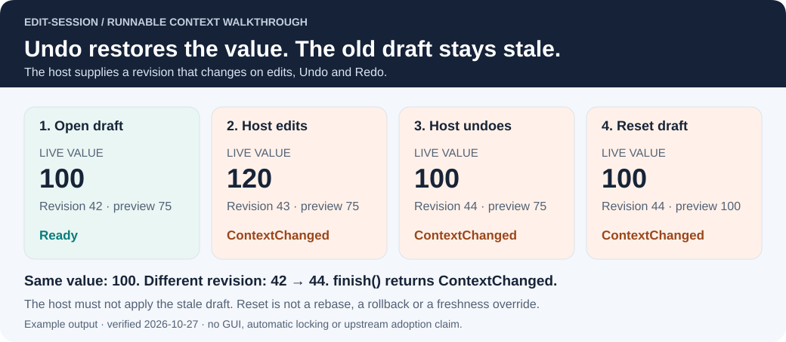

# Same value, different edit

An open draft remembers the value and context from when editing began. If another
action changes the document and Undo restores the original value, the old draft is
still based on an earlier revision. Comparing only values misses that history.

Run the [complete Rust example](../examples/context_walkthrough.rs) from a checkout:

```sh
cargo run --locked --example context_walkthrough
```

It calls the real library, uses no third-party dependencies, and checks its results
with assertions. It is an original synchronous teaching model, not a GUI test or a
newly discovered bug in an application. Rust 1.88+ is sufficient.

| Action | Live value | Host revision | Draft preview | `check` |
| --- | ---: | ---: | ---: | --- |
| Open draft, propose 75 | 100 | 42 | 75 | `Ok(())` |
| Another host edit | 120 | 43 | 75 | `ContextChanged` |
| Host Undo | 100 | 44 | 75 | `ContextChanged` |
| Reset the old draft | 100 | 44 | 100 | `ContextChanged` |

The original revision remains 42. `finish` returns `ContextChanged`, including after
Reset. The host must reject or dismiss this stale draft rather than apply it to the
newer state. A deliberate reload/reopen can start a **new** session; Reset cannot.



## What the application must supply

The library does not observe edits or increment revisions. The application supplies
stable document and target identities, and a revision that changes on every relevant
edit, Undo and Redo. A wrapping or reused revision can make a different state appear
current; choose a counter/identity scheme that avoids reuse during a session's lifetime.

Use owned snapshots or immutable shared values. Cloning a pointer to shared mutable
storage does not isolate the draft. Equality must cover all relevant fields.

Freshness checks and command execution must share the application's serialized edit
path. A successful check followed by a separately scheduled write is not protected
from intervening changes. The library provides no lock or transaction rollback.

For a host command that may reject an edit, use the existing
[retry example](RECOVERY.md): check, borrow the preview, try the atomic host command,
and close only after success. Retain raw input on rejection. Calling `finish` first
consumes the session and is not a retry strategy.

## Why use a library instead of a small struct?

A correct local helper can implement the same checks. This example demonstrates the
contract, not code savings or an advantage over that helper. The reusable part is one
tested implementation of draft validity, original/preview values and context checks.
It is worth a dependency only when consumers need that shared contract.

| Existing situation | Reasonable choice |
| --- | --- |
| A simple dialog with working local draft logic | Keep the local helper unless a concrete gap is demonstrated |
| Several consumers need the same draft contract | Evaluate edit-session against the same native regression tests |
| Preview, workspace reload or backup already solves the need | Keep that workflow; a new dependency needs a separate reason |
| A useful regression can be expressed as a native Rust test | Use that test; interaction-check is optional |
| A renderer, Undo engine, asynchronous transaction or conflict merge is missing | Solve that in the host; this library does not provide it |

These choices reflect [Oculante, SSBH Editor and Tarsier feedback](ADOPTION.md#what-feedback-changes-our-approach).
The [PdfCraft evidence](ADOPTION.md#a-demonstrated-failure-in-a-real-consumer) concerns a
complete proposed consumer patch, including host changes. It does not prove that an
external crate is preferable to a local helper, and neither integration is adopted.

## Reproduce the diagram

```sh
cargo build --locked --example context_walkthrough
python tools/context_evidence.py
python tools/context_evidence.py --check
```

Python is used only to render/verify the repository graphic; using the crate and
running its Rust examples do not require it. Pass `--binary PATH` if Cargo uses a
custom target directory. The script runs the example's `--json` mode, records its
output and LF-normalized source hashes in [the snapshot](evidence/context-walkthrough.json),
and renders the SVG from those values. CI checks both on Rust 1.88 and stable.
These walkthrough assertions are separate from the existing 16 lifecycle tests,
8 recovery tests and one compile-fail doctest; they are not new upstream regressions.
